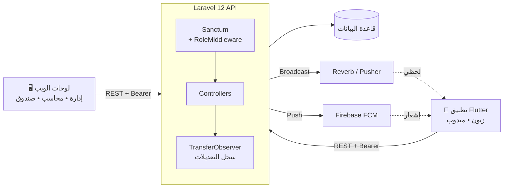

<div align="center">

# ⚡ FlashPay — الخادم (Back-end API)

**واجهة برمجية متكاملة لإدارة الحوالات، الصناديق، أسعار الصرف، والمحادثات اللحظية.**

<p>
  
  
  
  
  
</p>

[المعمارية](#-المعمارية) • [الأدوار](#-الأدوار-والصلاحيات) • [الوحدات](#-الوحدات) • [API](#-أهم-المسارات) • [التثبيت](#-التثبيت) • [البيئة](#-متغيرات-البيئة)

</div>

---

<div dir="rtl">

## 📖 نبذة

هذا المستودع هو **قلب منظومة FlashPay**: يخدم تطبيق الموبايل ولوحات الويب عبر REST API، ويدير الحوالات (محلية، دولية، بنكية، داخلية) وكل الصناديق المالية وأسعار العملات، ويبثّ الرسائل لحظياً ويرسل إشعارات الدفع.

## 🧩 منظومة FlashPay

| المستودع | الوصف |
|---|---|
| 🛠️ **FlashPay-Back** (هذا المستودع) | الـ API — Laravel |
| 📱 [Flash-Pay](https://github.com/ghaiethka-dev/Flash-Pay) | تطبيق الموبايل — Flutter |
| 🖥️ [FlashPay-Front](https://github.com/Kaisalafef/FlashPay-Front) | لوحات الإدارة على الويب |

## 🏗️ المعمارية



## 👥 الأدوار والصلاحيات

الصلاحيات تُفرض عبر وسيط `role:` على كل مجموعة مسارات.

| الدور | الوصف | يعمل من |
|---|---|---|
| `super_admin` | الإدارة العليا: المكاتب، الموظفون، أسعار الصرف، الخزنة العليا، الإقفال الشهري | الويب |
| `admin` | مدير المكتب: اعتماد الحوالات والحوالات البنكية، الصناديق والأرباح | الويب |
| `accountant` | المحاسب: التقارير، الإقفال الشهري، سجل التعديلات، سجل الصناديق | الويب |
| `cashier` | الصندوق: تسليم الحوالات وإتمام الحوالات البنكية، التداول | الويب |
| `agent` | المندوب: إرسال حوالات، حوالات بنكية، صندوق المندوب | الموبايل |
| `customer` | الزبون: إنشاء الحوالات ومتابعتها والمحادثة | الموبايل |

## 🧱 الوحدات

| الوحدة | ما تقدّمه |
|---|---|
| 💸 **الحوالات** | إنشاء، تحديث الحالة، تعديل، أرشيف، وتسجيل تلقائي لكل تغيير عبر `TransferObserver` |
| 🏦 **حوالات البنك** | إنشاء من المندوب ← موافقة/رفض من الإدارة ← إتمام من الصندوق |
| 🔁 **الحوالات الداخلية** | بين المكاتب، مع تبديل حالة «مدفوعة» |
| 🗄️ **الصناديق** | رئيسي • أعلى (Super) • مكتب • تداول • أرباح • إلكتروني • صناديق إضافية، مع سجل لكل حركة |
| 📈 **التداول** | شراء وبيع عملات، تقرير يومي وتفصيلي، تكلفة متوسطة |
| 💱 **العملات والأسعار** | أسعار الصرف يدوياً أو تلقائياً عبر الأمر `currencies:update` |
| 🗓️ **الإقفال الشهري** | أرشفة الحوالات ولقطات الصناديق لكل شهر |
| 💬 **المحادثات** | رسائل لكل حوالة مع صور، بثّ لحظي عبر Reverb/Pusher |
| 🔔 **الإشعارات** | Firebase Cloud Messaging عبر `FcmService` |
| 🌍 **البيانات المرجعية** | الدول، المدن، المكاتب |

## 🔌 أهم المسارات

> كل المسارات تحت البادئة `/api`. المسارات المحمية تتطلب `Authorization: Bearer <token>`.

**عامة**

| الطريقة | المسار | الوصف |
|---|---|---|
| `POST` | `/register` • `/login` | إنشاء حساب / دخول |
| `GET` | `/countries` • `/cities` • `/currencies` | بيانات مرجعية |

**أي مستخدم مسجّل**

| الطريقة | المسار | الوصف |
|---|---|---|
| `GET` | `/me` • `/profile` | بيانات المستخدم |
| `PUT` | `/profile/update` | تحديث الحساب |
| `POST` | `/update-fcm-token` | تسجيل رمز الإشعارات |
| `GET` `POST` | `/transfers` | عرض وإنشاء الحوالات |
| `GET` `POST` | `/transfers/{id}/messages` | محادثة الحوالة |
| `GET` | `/offices` • `/agents` • `/bank-transfer` | قوائم |
| `POST` | `/logout` | خروج |

**حسب الدور**

| الدور | أمثلة |
|---|---|
| `super_admin` | `/offices` (CRUD) • `/super-safe/*` • `/safes/*` • `/currencies/update-price/{id}` • `/monthly-closing` • `/users/{id}/toggle-status` • `/extra-boxes` |
| `admin` | `/bank-transfer/{id}/approve` • `/bank-transfer/{id}/reject` • `/safes/*` |
| `accountant` / `cashier` | `/safes` • `/trading/buy` • `/trading/sell` • `/internal-transfers` • `/transfers/{id}/update-status` |
| `cashier` | `/bank-transfer/{id}/complete` |
| `agent` | `/agent/safe` • `/agent/transfers` • `POST /bank-transfer` |

## ⚙️ التثبيت

**المتطلبات:** PHP ≥ 8.2 • Composer • Node.js ≥ 18 • MySQL/MariaDB (أو أي قاعدة يدعمها Laravel).

```bash
# 1) استنسخ المشروع
git clone https://github.com/Ameerdawara/FlashPay-Back.git
cd FlashPay-Back

# 2) ثبّت الاعتماديات
composer install
npm install

# 3) جهّز البيئة
cp .env.example .env        # إن لم يوجد الملف أنشئ .env يدوياً من القائمة أدناه
php artisan key:generate

# 4) قاعدة البيانات
php artisan migrate --seed
php artisan storage:link    # لعرض الصور (إيصالات، هويات)

# 5) شغّل الخدمات
composer run dev            # خادم + queue + logs + vite
php artisan reverb:start    # البث اللحظي (في نافذة منفصلة)
```

**أوامر مفيدة**

```bash
php artisan currencies:update   # جلب أسعار العملات من API خارجي
php artisan test                # تشغيل الاختبارات
```

**فحص الصحة:** `GET /up`

## 🔐 متغيرات البيئة

| المجموعة | المتغيرات |
|---|---|
| التطبيق | `APP_NAME` `APP_ENV` `APP_KEY` `APP_DEBUG` `APP_URL` |
| قاعدة البيانات | `DB_CONNECTION` `DB_HOST` `DB_PORT` `DB_DATABASE` `DB_USERNAME` `DB_PASSWORD` |
| البث اللحظي | `BROADCAST_CONNECTION` `REVERB_APP_ID` `REVERB_APP_KEY` `REVERB_APP_SECRET` `REVERB_HOST` `REVERB_PORT` `REVERB_SCHEME` |
| Pusher | `PUSHER_APP_ID` `PUSHER_APP_KEY` `PUSHER_APP_SECRET` `PUSHER_APP_CLUSTER` |
| الإشعارات | `FIREBASE_CREDENTIALS` (مسار ملف Service Account) |
| الطوابير والكاش | `QUEUE_CONNECTION` `CACHE_STORE` `SESSION_DRIVER` |
| البريد | `MAIL_MAILER` `MAIL_HOST` `MAIL_PORT` `MAIL_USERNAME` `MAIL_PASSWORD` `MAIL_FROM_ADDRESS` |

> ⚠️ لا ترفع ملف `.env` ولا ملف Firebase Service Account إلى المستودع.

## 🗂️ بنية المشروع

```
app/
├── Http/
│   ├── Controllers/     # Auth, Transfer, BankTransfer, Chat, Safes, Currency, ...
│   └── Middleware/      # RoleMiddleware (role:super_admin,admin,...)
├── Models/              # User, Transfer, MainSafe, OfficeSafe, TradingSafe, ...
├── Observers/           # TransferObserver → TransferHistory
├── Events/              # MessageSent (broadcast)
├── Services/            # FcmService
└── Console/Commands/    # UpdateCurrencyRates
database/
├── migrations/          # الجداول والصناديق والإقفال الشهري
└── seeders/             # Country • City • Currency • SuperAdmin
routes/
├── api.php • User.php   # مسارات الـ API
├── channels.php         # قنوات البث
└── console.php
```

## 👥 الفريق

| الاسم | الدور |
|---|---|
| أمير دوارة | مهندس برمجيات |
| قيس العفيف | مهندس برمجيات |
| غيث كحل | مهندس برمجيات |
| دلع عدوان | مهندسة برمجيات |

## 📄 الترخيص

مشروع خاص بـ **FlashPay**. جميع الحقوق محفوظة © 2026.

</div>
